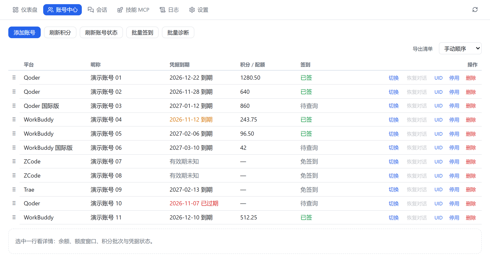
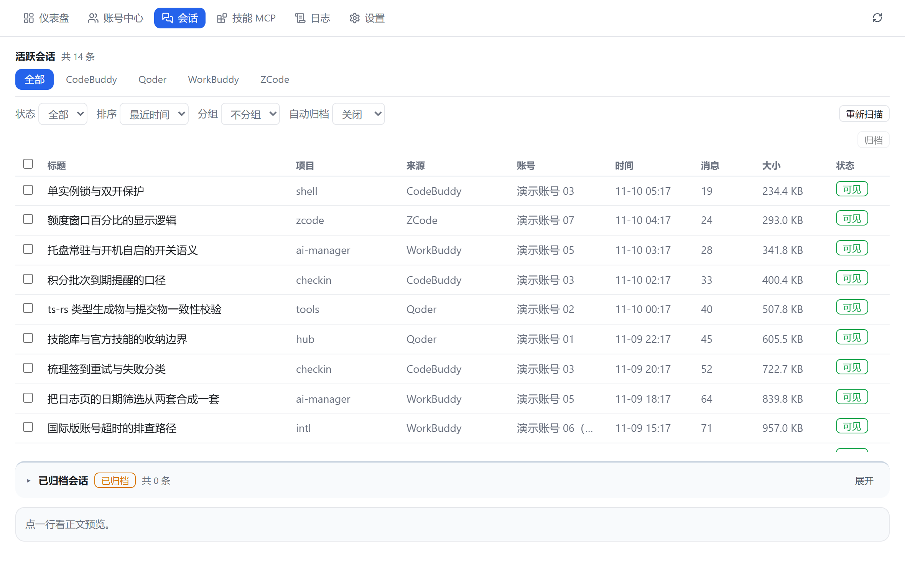
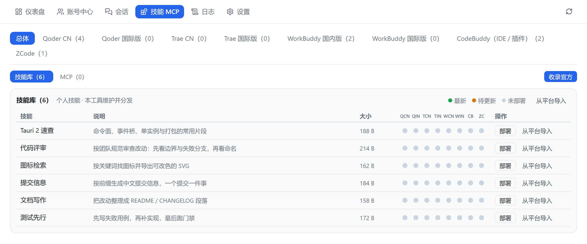

<div align="center">

<sub><b>English</b> · <a href="README.zh-CN.md">简体中文</a></sub>

# AI Manager

**You have three AI coding clients, and you spend the day switching between their logins.**
This tool puts switching, check-in, sessions and skills into one window.

Windows desktop · multi-account login switching · daily check-in & credits · local session library · skills & MCP distribution

[](https://github.com/FaustDream/AI-Manager/actions/workflows/ci.yml)
[](https://github.com/FaustDream/AI-Manager/releases)
[](#install)
[](LICENSE)

</div>

<p align="center">
  
</p>

## Why

Qoder, WorkBuddy, Trae and ZCode each keep their own login state, their own credential file, and their own daily check-in. With a few accounts, switching becomes manual labour: open the client, find the account, log in again, and one missed day breaks the streak.

AI Manager folds all of it into one window: it scans every account already logged in on this machine and switches with one click, records check-ins and credits automatically, indexes sessions so you can browse, delete and restore them in one place, and imports skills or MCP servers once to distribute them to multiple clients.

## Features

| Module | What it does |
| --- | --- |
| Dashboard | Account verdicts, credit flow and token usage on one screen |
| Account center | Scan local accounts, switch login state, daily check-in, credit ledger |
| Sessions | Browse and preview the local session library, delete to trash, restore |
| Skills & MCP | Import, distribute to each client, remove to trash, collect official skills |
| Logs | Action log and runtime log, date-range review, export |
| Settings | Launch at startup, tray behaviour, general options |

## Screens

Session library: one index across platforms, filter by source and state — deleted sessions go to trash and can be restored.

<p align="center">
  
</p>

Skills & MCP: import once, distribute per platform, and the matrix shows at a glance which platforms are still missing it.

<p align="center">
  
</p>

## Supported platforms

| Platform | Account switching | Session library |
| --- | --- | --- |
| Qoder (China / International) | Yes | Yes |
| WorkBuddy (China / International) | Yes | Yes |
| ZCode | Yes | Yes |
| Trae | No | — |

Trae stores its login state in a device-bound encrypted format that cannot be written back safely, so switch accounts inside the Trae client itself. Check-in and credits are implemented per provider; the UI only shows the entry points a platform actually supports.

> The application UI is currently Chinese only. The screenshots above show the real interface.

## Install

Both artifacts live in [Releases](https://github.com/FaustDream/AI-Manager/releases):

| Artifact | Use it when |
| --- | --- |
| `AI-Manager-<ver>-windows-x64-setup.exe` | Normal install. Goes to `%LOCALAPPDATA%\Programs\AI Manager`, no admin rights, uninstall keeps `data\` |
| `AI-Manager-<ver>-windows-x64-portable.zip` | Unzip and run. Move the whole folder to migrate |

Requirements: Windows 10 1803 or later (uses the system WebView2 runtime, bundled on Windows 11). No .NET, no administrator rights.

> Closing the window does not quit: the app stays in the tray to keep running the daily check-in. To really exit, right-click the tray icon and choose "退出" (Quit).

> **Unsigned build.** On first launch Windows SmartScreen may show "Windows protected your PC" — choose "More info" → "Run anyway". Every release ships a `SHA256SUMS.txt` so you can verify what you downloaded.

## Build from source

Prerequisites: Rust stable, Node.js 22, WebView2 (bundled on Windows 11). Building the installer additionally needs NSIS.

```bash
npm ci

# Development: two terminals
npm run dev                                  # terminal 1: Vite dev server (127.0.0.1:5273)
cd src-tauri && cargo run --bin ai-manager   # terminal 2: desktop shell, connects to 5273

# Release build
npm run build
cd src-tauri && cargo build --release --features custom-protocol
```

`--bin ai-manager` is required: `src-tauri` has two binaries (`ai-manager` and the web debug shell `ai-manager-web`) and Cargo has no default target.

`custom-protocol` is also required, otherwise the release build tries to reach devUrl and shows a blank window.

To debug the UI in a browser: `cargo run --bin ai-manager-web`. It binds `127.0.0.1` only and shares the single-instance lock with the desktop shell, so the two cannot run at once.

The pre-commit gates match CI:

```bash
npm test && npm run build

cd src-tauri
cargo fmt --all -- --check
cargo clippy --all-targets --features ts -- -D warnings
cargo test --lib --tests --features ts
```

`--features ts` regenerates `src/lib/types/`. If you change an IPC type on the Rust side you must commit the generated files too; CI verifies that the generated output matches what was committed.

## Data and privacy

Everything lives in a `data/` directory next to the executable. Nothing is uploaded anywhere:

```text
data/app.db      accounts, check-ins, credits, session index, skills and MCP (SQLite)
data/logs/       runtime logs
data/backups/    automatic backup taken before writing client configs
data/skills/     skill library
data/trash/      recycle bin for removed items
```

Account credentials are encrypted with Windows DPAPI and bound to the current Windows user. After switching user or machine you must log in again — that is deliberate, not a defect.

## Known limitations

- Windows only: depends on DPAPI and WebView2
- The account vault does not migrate: copying `data/` over still requires a fresh login
- Upgrading from v1: the v1 data importer is gone; the app neither reads nor deletes the old directory

## Contributing

This is a single-maintainer project. Please use [Issues](https://github.com/FaustDream/AI-Manager/issues/new/choose) and read [CONTRIBUTING.md](CONTRIBUTING.md) first. Do not open a public issue for security problems — see [SECURITY.md](SECURITY.md). Changes are recorded in [CHANGELOG.md](CHANGELOG.md).

## License

Custom terms — read [LICENSE](LICENSE). In short:

- **Allowed**: use it (including at work), modify it for yourself, redistribute it unmodified with attribution intact
- **Not allowed**: remove or alter the attribution, redistribute a rebranded copy, sell it or bundle it into a paid product
- SPDX identifier: `LicenseRef-AI-Manager-1.0`. GitHub reports this as "Other" because it is not an OSI-approved license.
