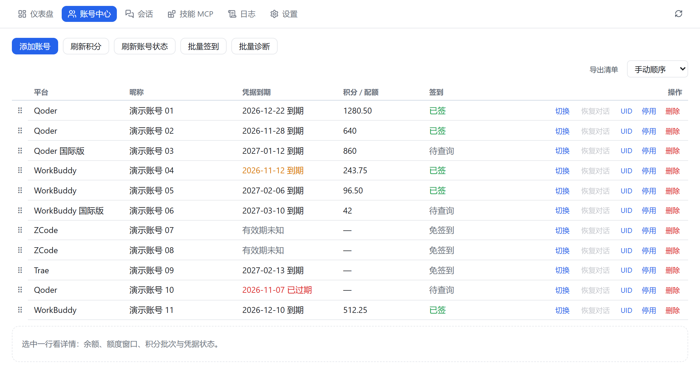
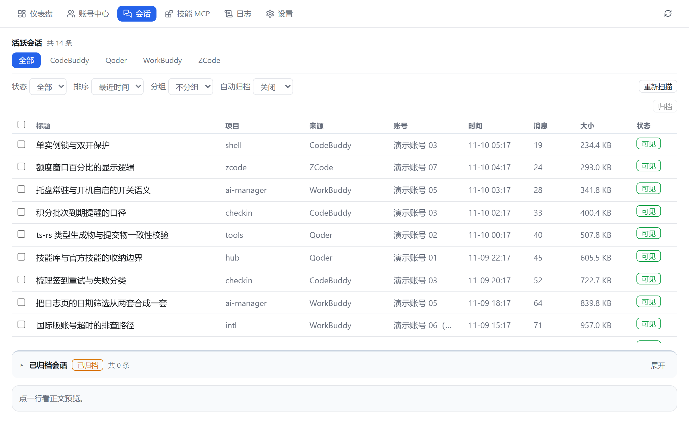
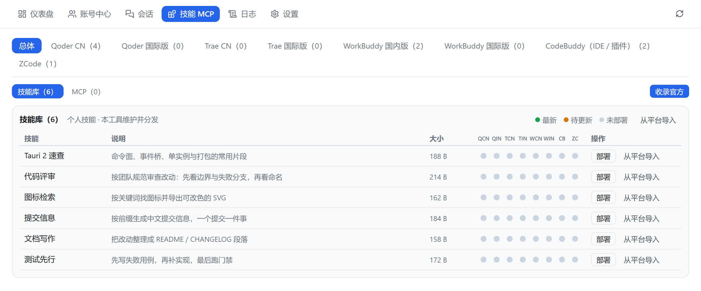

<div align="center">

<sub><a href="README.md">English</a> · <b>简体中文</b></sub>

# AI Manager

**你有三个 AI 编程客户端，每天在它们的登录态之间来回切。**
这个工具把切换、签到、会话、技能收进一个窗口。

Windows 桌面端 · 多账号登录态切换 · 每日签到与积分 · 本地会话库 · 技能与 MCP 分发

[](https://github.com/FaustDream/AI-Manager/actions/workflows/ci.yml)
[](https://github.com/FaustDream/AI-Manager/releases)
[](#安装)
[](LICENSE)

</div>

<p align="center">
  
</p>

## 为什么需要它

Qoder、WorkBuddy、Trae、ZCode 各有一套登录态，各存一份凭据，各自要签到。账号一多，切换就成了体力活：翻客户端、找账号、重新登录、忘签一天断掉连续记录。

AI Manager 把这些收进一个窗口：扫出本机所有已登录账号，一键切过去；签到与积分自动记账；会话库统一浏览、删除与恢复；技能和 MCP 一次导入、分发到多个客户端。

## 功能

| 模块 | 做什么 |
| --- | --- |
| 仪表盘 | 账号结论、积分收支、Token 用量同屏看完 |
| 账号中心 | 扫描本机账号、一键切换登录态、每日签到、积分台账 |
| 会话 | 本地会话库浏览与预览、删除进回收站、可恢复 |
| 技能 MCP | 技能与 MCP 导入、分发到各客户端、移除进回收站、官方技能收录 |
| 日志 | 执行动作与运行日志双视图、按日期回看、导出 |
| 设置 | 开机自启、托盘行为、通用选项 |

## 界面

会话库：跨平台会话统一索引，按来源与状态筛选，删除进回收站还能捞回来。

<p align="center">
  
</p>

技能 MCP：导入一次，按平台分发，矩阵里一眼看出哪些平台还缺。

<p align="center">
  
</p>

## 支持平台

| 平台 | 账号切换 | 会话库 |
| --- | --- | --- |
| Qoder（国内版 / 国际版） | 支持 | 支持 |
| WorkBuddy（国内版 / 国际版） | 支持 | 支持 |
| ZCode | 支持 | 支持 |
| Trae | 不支持 | — |

Trae 的登录态是设备绑定的加密格式，无法安全写回，请在 Trae 客户端内手动切换。签到与积分按各家接口分别实现，界面上只显示该平台实际支持的入口。

## 安装

两个产物都在 [Releases](https://github.com/FaustDream/AI-Manager/releases)：

| 产物 | 适合 |
| --- | --- |
| `AI-Manager-<ver>-windows-x64-setup.exe` | 常规安装。装到 `%LOCALAPPDATA%\Programs\AI Manager`，免管理员，卸载保留 `data\` |
| `AI-Manager-<ver>-windows-x64-portable.zip` | 解压即用。换机器把整个文件夹拷走 |

系统要求：Windows 10 1803 及以上（依赖系统自带的 WebView2 运行时，Win11 自带）。不需要 .NET，不需要管理员权限。

> 关窗口不退出：程序收进托盘继续跑每日签到。要真正退出，右键托盘图标选「退出」。

> **未签名构建。** 首次启动时 Windows SmartScreen 可能提示「Windows 已保护你的电脑」，点「更多信息」→「仍要运行」即可。每个 Release 都附带 `SHA256SUMS.txt`，可自行校验下载内容。

## 从源码构建

前置：Rust stable、Node.js 22、WebView2（Win11 自带）。打安装包另需 NSIS。

```bash
npm ci

# 开发：开两个终端
npm run dev                                  # 终端 1：Vite 开发服务器（127.0.0.1:5273）
cd src-tauri && cargo run --bin ai-manager   # 终端 2：桌面壳，连上面的 5273

# 发布构建
npm run build
cd src-tauri && cargo build --release --features custom-protocol
```

`--bin ai-manager` 不能省：`src-tauri` 下有两个二进制（`ai-manager` 与网页调试壳 `ai-manager-web`），Cargo 没有默认目标。

`custom-protocol` 也不能省，否则 release 版会去连 devUrl，表现为白屏。

想在浏览器里调界面：`cargo run --bin ai-manager-web`。它只绑 `127.0.0.1`，且与桌面版共用单实例锁，两个不能同时开。

提交前的门禁与 CI 一致：

```bash
npm test && npm run build

cd src-tauri
cargo fmt --all -- --check
cargo clippy --all-targets --features ts -- -D warnings
cargo test --lib --tests --features ts
```

`--features ts` 会重新生成 `src/lib/types/`。改了 Rust 端 IPC 类型就必须把生成物一起提交，CI 会校验「生成物 = 提交物」。

## 数据与隐私

全部数据都在 exe 同级的 `data/` 目录，不上传任何地方：

```text
data/app.db      账号、签到、积分、会话索引、技能与 MCP（SQLite）
data/logs/       运行日志
data/backups/    写客户端配置前的自动备份
data/skills/     技能库
data/trash/      移除项的回收站
```

账号凭据用 Windows DPAPI 加密，与当前 Windows 用户绑定。换用户或换机器后需要重新登录——这是有意为之，不是缺陷。

## 已知限制

- 仅 Windows：依赖 DPAPI 与 WebView2
- 账号库不跨机器迁移：拷走 `data/` 之后仍需重新登录
- 从 v1 升级：v1 数据导入器已下线，程序不会读取或删除旧版目录

## 参与

单人维护的项目。问题请走 [Issue](https://github.com/FaustDream/AI-Manager/issues/new/choose)，提之前先看 [CONTRIBUTING.zh-CN.md](CONTRIBUTING.zh-CN.md)。安全问题不要开公开 Issue，见 [SECURITY.zh-CN.md](SECURITY.zh-CN.md)。改动记录在 [CHANGELOG.md](CHANGELOG.md)。

## 许可

自定义条款，见 [LICENSE](LICENSE)。三句话说完：

- **可以**：自用（含公司内部使用）、自行修改、原样分发并保留署名
- **不可以**：去掉或篡改署名、改名后分发、打包出售或捆绑进付费产品
- SPDX 标识：`LicenseRef-AI-Manager-1.0`。GitHub 显示为 `Other`，因为它不是 OSI 认可的开源协议
